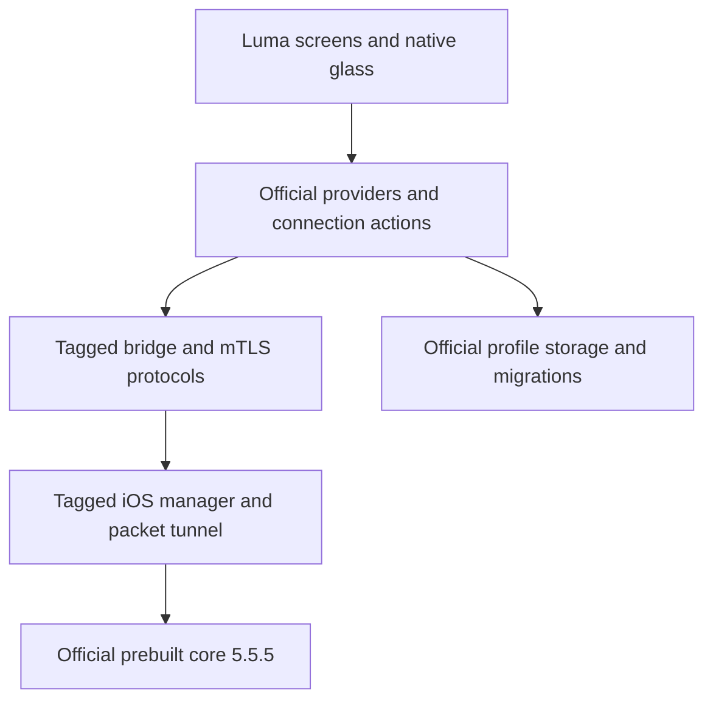
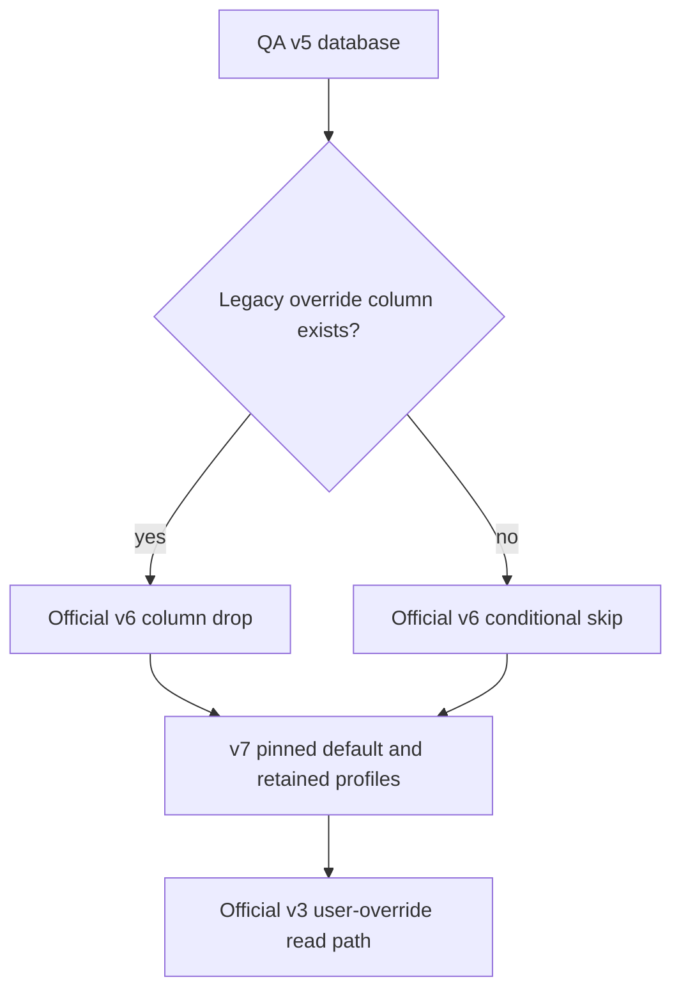

# Luma on Hiddify 5.5.5 - Plan

## Goal Capsule

- Objective: luma users can continue importing subscriptions, selecting servers and connecting with the current official Hiddify release while retaining luma's familiar interface and saved data.
- Means: integrate the matched stable app/core 5.5.5 through KTD1–KTD3.
- Authority: the user's approved scope governs product behavior; the official tagged sources govern technical behavior; this plan governs integration and verification.
- Execution profile: implement and verify in the isolated user-owned fork; the parent executor finishes integration and records evidence.
- Stop conditions: report a genuine incompatibility that requires changing an approved product decision, data loss, or unavailable verification infrastructure. Do not silently weaken acceptance.
- Shipping: no upstream submission, merge or TestFlight publication is authorized by this plan; the caller may open the already-authorized PR in the user-owned fork.

---

## Product Contract

### Summary

Update luma's official Hiddify foundation to the matched stable app and core 5.5.5. Keep the redesigned presentation and simplified journeys, and use official technical components beneath them.

### Problem Frame

The preserved QA45 application is based on app 4.1.1/core 4.1.0 and has accumulated custom connection and diagnostic behavior. A superficial version bump would omit release changes and leave incompatible API assumptions under luma's interface.

### Requirements

**Release foundation**

- R1. Account for every official app change from the existing upstream baseline through app tag `upstream/v5.5.5` (`7804cad`) and pair it with core v5.5.5.
- R2. Record post-release `upstream/main` changes separately from the stable baseline, with an explicit inclusion or deferral decision for each distinct change.
- R3. Prefer official technical implementations and existing native components over keeping the custom backend or adding compatibility layers.

**Luma continuity**

- R4. Preserve luma's redesign and simplified import, profile, server selection, settings and connection journeys without exposing unrelated upstream screens.
- R5. Preserve existing profiles, active selection, subscription metadata and supported user preferences through the official migrations.
- R6. Preserve QA45 app, tunnel extension, AppGroup, service and release-signing identities, including the existing separation between application identity and service identity.
- R7. Retain the existing exact-provider VPN profile selection and bounded stale-preferences save retry when the tagged implementation still selects an unrelated first manager.

**Verification and scope**

- R8. Prove the integrated Dart application, native iOS/core boundary and data upgrade with reproducible checks, then distinguish visual-host evidence from physical-device VPN evidence.
- R9. Limit removals to obsolete custom components and references displaced by this migration; record unrelated findings without fixing them.

### Key Decisions

- Official technical code takes priority over retaining the custom backend. Governs R3, R7. (session-settled: user-directed — chosen over preserving bespoke connection infrastructure: reduce custom maintenance while keeping the luma product.)
- Use the matched stable app/core 5.5.5 release. Governs R1, R2. (session-settled: user-approved — chosen over using moving main as the baseline: stable provenance and matched native APIs.)

### Scope Boundaries

No new backend, authentication product, remote server changes, diagnostic platform redesign, unrelated cleanup, additional user features or automatic publication. Existing upload workflow protections stay in place; verification must not dispatch its upload operation.

Considered and not built: a parallel legacy runtime or broad compatibility facade. It would duplicate official ownership without serving the agreed journeys; reconsider only if a concrete preserved journey cannot bind to the tagged APIs.

### Acceptance Examples

- AE1. Covers R4, R8. With no profile, pressing Connect shows the existing luma import/selection flow. With an active profile, it invokes the official connection action and displays its real state.
- AE2. Covers R5. Opening a synthetic QA v5 database with or without the legacy nullable `profile_override` column upgrades to v7 and retains the same profile identities and active selection.
- AE3. Covers R6, R7. With an unrelated saved VPN manager present, connection targets luma's exact provider; one stale-save recovery retries the intended profile without enabling automatic reconnect.

---

## Planning Contract

### Key Technical Decisions

- KTD1. Merge the official stable tag into the preserved branch, retaining ancestry, rather than transplanting a new source tree. Resolve conflicts by ownership and produce a release-change accounting table. Common base is `abbd671`; the non-mutating merge preview found about 67 conflicts.
- KTD2. Take technical subsystems as matched upstream units: bridge, generated protocols/bindings, connection lifecycle, configuration, routing, profile parsing, database and platform integration. This implements R3. (session-settled: user-directed — chosen over porting each release change into bespoke backend code: keep the official technical model.)
- KTD3. Keep luma presentation files and rebind mixed widgets to official providers/actions. This implements R4 through `connection_button.dart`, `active_proxy_card.dart`, the adaptive shell and feature screens, rather than recreating old providers behind adapters.
- KTD4. Adopt upstream managed status/start/client-change APIs and actual mTLS credentials together. Do not revive `systemStatus` assumptions or replace mTLS with an insecure channel to make old tests pass.
- KTD5. Use the official DB v5→v6 conditional column drop, v6→v7 pinned default, and user-override v1→v2→v3 transformation, including `adminPreference`. Add only a demonstrated QA-variant compatibility correction; do not revive the obsolete `profile_override` storage contract.
- KTD6. Reuse the existing digest-bound iOS prebuilt preparation and artifact-verification tools. Parent research verified the official core v5.5.5 archive at 111283683 bytes with SHA256 `7b14e3a657a000d0200bb40f30b3d6796854219bb0b5b72c38e3f4d456601a8b`.

### High-Level Technical Design

### Assumptions

The preserved source `d59ee70b` contains QA45 `3ed0a966`; no existing user data is used as a disposable test fixture. Physical-device access and signing availability are checked during implementation and any unavailable gate is reported as unverified. Existing Flutter 3.38.5 is a reusable toolchain matching the upstream manifest's minimum Flutter and Dart requirements.

### Risks and Dependencies

The old and new bridge contracts cannot be mixed. A successful widget test cannot validate extension linkage, mTLS, shared container access or real traffic. Adopt upstream iOS 15.5 minimum rather than retaining local 15.0 with unverified support, and record the resulting supported-OS change.

Three commits on main after the stable tag comprise two distinct changes: `ea08fb5b` changes Warp/Psiphon naming; `4cc86c4e` accepts an unpadded base64 profile-title; `0d6eb882` merges the parser fix. Default to deferring both distinct changes outside this stable baseline and document their affected files and tests without duplicating the merge commit as another fix.

---

## Implementation Units

### U1. Merge the matched official technical baseline

- Goal: integrate the stable tagged application, runtime, native bridge and data migrations as one compiling foundation.
- Requirements: R1–R3, R5, R8, R9; KTD1, KTD2, KTD4–KTD6.
- Dependencies: none.
- Files: `pubspec.yaml`, `pubspec.lock`, `Makefile`, tagged platform/build changes, `lib/hiddifycore/`, `lib/gen/`, `lib/features/connection/`, `lib/singbox/`, `lib/core/db/`, `lib/core/preferences/`, `lib/features/profile/`, official configuration/routing models, `ios/Runner/VPN/VPNManager.swift`, `ios/HiddifyPacketTunnel/`; existing `test/features/connection/data/connection_repository_test.dart`, `test/hiddifycore/hiddify_core_service_init_test.dart`, `test/drift/db/migration_test.dart`, `test/features/profile/data/profile_parser_test.dart`; existing `test/features/profile/model/user_override_migration_test.dart`.
- Approach:
  1. Perform the actual merge under KTD1, classify conflicts by technical/presentation/mixed ownership, and account for every released subsystem plus the post-tag dispositions recorded above.
  2. Adopt KTD2/KTD4 together. Remove displaced lifecycle/diagnostic hooks only where needed by the new APIs; update callers instead of recreating legacy backend ownership.
  3. Adopt KTD5 with synthetic QA variants. Read `lib/core/db/README.md` for generated migration tooling. Inspect legacy override semantics and port a preserved control to supported official fields when required.
- Execution note: this coordinated unit may require simultaneous bridge/model/caller changes to compile. Characterize meaningful behavior first; replace obsolete API-specific assertions with official observable behavior checks.
- Patterns to follow: tagged mobile bridge, managed notifier, database migrations and packet tunnel sources.
- Test scenarios:
  1. Supported profile starts, reports official connecting/connected/error states and stops through the managed API.
  2. Bridge initialization failure reaches an observable error rather than remaining pending; foreground entry does not duplicate start or custom recovery.
  3. Covers AE2. Standard v5 and QA v5 without `profile_override` migrate to v7 with IDs, active selection, metadata, headers and supported user options intact.
  4. v6→v7 supplies `pinned=false`; fresh v7 creation and reopening a migrated database succeed.
  5. Supported v1 and v2 user overrides convert through official v3 semantics, including `adminPreference`; absent overrides retain official defaults.
  6. Existing parser fixtures and supported imports retain expected content and settings.
  7. Native compilation proves matched protocol symbols, framework slices and extension linkage; successful authenticated runtime RPC on device proves the mTLS boundary.
- Verification: exact stable ancestry exists, each upstream release area is explained, migration/runtime tests pass, and the coordinated runtime compiles after U2 resolves its presentation and identity callers.

### U2. Preserve luma presentation and native identity compatibility

- Goal: preserve the visible product and its installed iOS identity on official state/actions.
- Requirements: R4–R8; KTD3.
- Dependencies: U1; mixed caller fixes can be prepared concurrently and integrated before U1's final compile.
- Files: `lib/core/theme/blizzard_theme.dart`, `lib/core/theme/blizzard_tokens.dart`, `lib/core/widget/blizzard/`, `lib/core/router/adaptive_layout/`, `lib/core/router/go_router/routing_config_notifier.dart`, `lib/features/home/widget/connection_button.dart`, `lib/features/proxy/active/active_proxy_card.dart`, affected luma profile/settings/import screens; `ios/Runner.xcodeproj/project.pbxproj`, `ios/Base.xcconfig`, `ios/Runner/VPN/VPNManager.swift`, `ios/Runner/Runner.entitlements`, `ios/HiddifyPacketTunnel/HiddifyPacketTunnel.entitlements`; existing `test/ios/vpn_manager_manual_policy_test.sh`, `test/ui_preservation/connection_contract_test.dart`, `test/ui_preservation/profile_import_contract_test.dart`, `test/visual/blizzard_native_connection_control_test.dart`, `test/visual/luma_profiles_sheet_gesture_test.dart`, `test/visual/luma_subscription_limit_test.dart`.
- Approach:
  1. Keep standalone theme/native glass components and replace mixed widgets' backend bindings under KTD3. Accept official route definitions before preserving the luma shell and simplified destinations.
  2. Restore R6 identity/settings and reapply only R7's exact-provider selection and bounded stale-save retry to the tagged native manager.
  3. Adopt upstream iOS 15.5 minimum and native dependencies. Keep official technical capabilities without widening visible navigation.
- Patterns to follow: existing luma presentation components and official feature repositories/actions.
- Test scenarios:
  1. Covers AE1. Empty and active-profile connect flows show the existing luma actions and real official statuses.
  2. Supported URL/scan/file import paths update the profile list and active choice through official repositories.
  3. Selecting a server changes the official active proxy and updates the luma card consistently.
  4. Existing profile gestures, dock, subscription-limit presentation, themes and accessibility states retain their contracts.
  5. Visual snapshots cover home, import, profile/server selection and settings in supported theme/viewport states.
  6. Covers AE3. Unrelated manager ordering and stale-save failure select and retry the intended provider exactly once without enabling automatic reconnect.
- Verification: focused native-policy, preservation and visual checks pass; QA45 and integrated screen states are compared using the same fixtures; app/extension identity inspection matches the preserved baseline.

### U3. Verify packaging and the integrated application

- Goal: produce a checked integration and reproducible evidence for the eventual release.
- Requirements: R1, R6, R8, R9; KTD6.
- Dependencies: U1, U2.
- Files: `scripts/prepare_ios_baseline_core.sh`, `.github/workflows/ios-baseline.yml`, affected official core version/build selectors, `test/security/ios_baseline_core_test.sh`, `test/ci/ios_baseline_workflow_test.rb`, `test/ci/ios_baseline_release_test.rb`, `test/ci/ios_baseline_identity_inventory_test.rb`, `test/ci/ios_baseline_signed_entitlements_test.rb`; new `docs/2026-11-07-hiddify-555-integration.md`.
- Approach: update coupled archive URL/size/digest/provenance assertions under KTD6, preserve extraction protections and publication gates, then run the Verification Contract and record actual outcomes and limitations. The report accounts for stable upstream changes, fork adaptations and deferred post-tag changes.
- Execution note: packaging needs artifact smoke checks and native compilation, rather than tests repeating a version string.
- Test scenarios:
  1. The verified official archive prepares successfully; altered bytes/size and unsafe archive layout are rejected by existing protections.
  2. Workflow and script provenance agree on 5.5.5, including upload-side expected values, without dispatching upload.
  3. App/extension/AppGroup/service identities and manual VPN policy match the preserved QA45 inventory.
  4. A real iPhone upgrade preserves profiles, completes authenticated runtime RPC and manual connect/disconnect, switches servers and carries actual traffic; record foreground/reconnect results distinctly.
- Verification: applicable gates below pass and the report differentiates real device, native compile and visual-host evidence; missing physical/signing checks remain explicitly unverified.

---

## Verification Contract

Use Flutter 3.38.5 and its bundled Dart from the existing pinned toolchain; do not rely on whichever SDK happens to be first on PATH. The source manifest requires Dart `^3.10.4` and Flutter `^3.38.5`.

| Gate | Check | Evidence |
|---|---|---|
| Dependency/generated consistency | `flutter pub get --enforce-lockfile`, `dart run build_runner build --delete-conflicting-outputs`, `dart run slang` | Lockfile and generated source match the merged official inputs; inspect any intended tracked changes. |
| Data upgrade | `flutter test test/drift/db/migration_test.dart` plus override migration tests | Synthetic v5 variants, v6 and fresh v7 produce the retained records defined by U1. |
| Runtime/UI | Focused tests in U1/U2, then `flutter test` | No failures dismissed merely as custom/upstream differences. |
| Analysis | `flutter analyze` | New errors fixed; unrelated pre-existing findings recorded with baseline evidence. |
| Native policy/packaging | `bash test/ios/vpn_manager_manual_policy_test.sh`, `bash test/security/ios_baseline_core_test.sh`, existing Ruby CI contract tests listed in U3 | Identity, extraction, digest and workflow assertions agree. |
| Native compile | Existing no-codesign `flutter build ipa --release --no-codesign --target lib/main_prod.dart` path using the prepared official core | Actual app and packet tunnel compile/link; a UI host alone is insufficient. |
| Device | U3 physical upgrade and traffic scenarios | Build/source, device OS, action and observed result recorded without secrets. |

Do not change trusted publication source SHAs simply to bypass workflow validation. If signed artifact inspection is unavailable, record source/build identity inspection and leave signed-artifact verification outstanding.

---

## Definition of Done

- Each R-ID is covered by completed implementation and the corresponding evidence; release-accounting distinguishes stable changes, fork adaptations and deferred post-release main changes.
- Every conflict has an ownership explanation; official runtime units remain matched and luma preservation checks pass.
- Saved-data migration and native compile evidence exist; physical-device and signed-artifact gaps are explicitly named rather than inferred from screenshots or mocks.
- No unrelated edits, abandoned experiments or obsolete migration-created references remain in the diff.
- The integration report states exactly what was verified and what remains before release; no merge or publication was performed.

## Execution receipt — 2026-11-07

U1–U3 implementation and applicable local verification completed. The actual upstream merge is `a2298c6b`; review corrections are `3fc6361e`. Simplification and independent review completed, including a recheck of both corrected findings. Detailed release accounting, test/capture evidence and physical-device/signing limitations are in [the integration report](../2026-11-07-hiddify-555-integration.md). Final native archive and analysis passed; native preference write/read survived separate process launches. The iOS scope has no browser acceptance target. No merge or TestFlight publication was performed.
